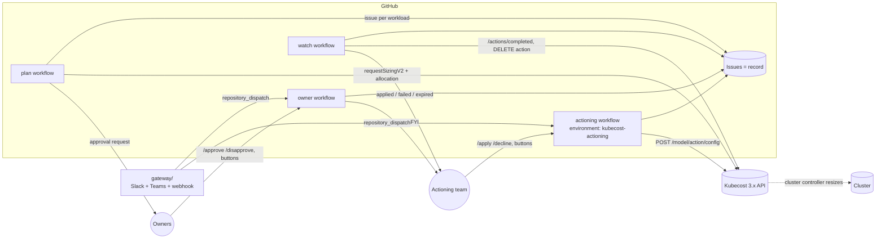

# Architecture

## Design choices
- **Kubecost API only.** The package never needs cluster credentials:
  - **Read:** recommendations come from `requestSizingV2` and cost evidence from the Allocation API.
  - **Write:** the change goes through Kubecost Actions, which Kubecost's cluster controller executes. Any standing Kubecost 3.x deployment works, as long as Actions and the cluster controller are enabled.
- **The recommendation and the change use the same profile.** The plan queries `requestSizingV2` with the parameters of the named Kubecost profile (Production / Development). The action then uses that profile by name. The API rejects `profile=` on `requestSizingV2`, so kcresize translates the profile into its parameters.
- **GitHub Issues as the record:**
  - One issue per workload, assigned to its owners, which also triggers GitHub's own email notifications.
  - A hidden base64 JSON block in the issue body holds the state.
  - Labels show the status. A history table in the body is the audit trail.
- **Owners are not part of the action:**
  - After the owner's decision, status changes are written as body and label edits rather than comments, so owners are not notified.
  - Work orders and status updates go to the actioning channels only.
- **Two gates on applying:**
  1. The actor must be in `actioning` (users, `@org/team`, or chat IDs).
  2. The job runs in the `kubecost-actioning` GitHub Environment. Add required reviewers there for a second human sign-off.
- **One-shot actions:**
  - Each approved workload gets its own action. The filter is `cluster+namespace+controllerName`, the maintenance window is the current and next UTC hour, and the name is `kcresize-<plan>-<ns>-<controller>`.
  - The window format (`* H * * DOW`) repeats weekly, so `watch` deletes the action once Kubecost reports a result.
- **Serialised state:** every workflow shares `concurrency: kcresize-state`, so two runs never edit the same issue at once.

## State machine
| From | Event | To | Who |
|---|---|---|---|
| — | plan | pending | kcresize (one issue each; blocked proposals are reported, not filed) |
| pending | `/approve [--force] <note>` | approved | owner |
| pending | `/disapprove <reason>` (reason required) | rejected | owner |
| approved | `/apply` | scheduled | actioning team (+ environment gate) |
| approved | `/decline <reason>` | declined | actioning team |
| approved | not actioned within `approvalTtlHours` | expired | watch |
| approved | spec changed or recommendation drifted > `driftPct` at apply | stale | apply |
| scheduled | Kubecost completed `success` for every container | applied | watch |
| scheduled | Kubecost completed `failed`/`error`, or timeout (`KCRESIZE_ACTION_TIMEOUT_H`, 6h) | failed | watch |

## Guardrails
| Setting | Default | Effect |
|---|---|---|
| `minChangePct` | 10 | Changes smaller than this are not proposed |
| `maxUpFactor` | 4 | Increases above this are blocked and never filed (a real lab case recommended 302,117m CPU) |
| `maxDownPctProd` | 80 | Larger production cuts need `/approve --force` |
| `driftPct` | 20 | At apply, Kubecost's current recommendation must be within 20% of what was approved |
| `approvalTtlHours` | 120 | Approvals expire if not actioned |
| `scope.exclude` | system namespaces | Never planned |

Also, an apply is refused if Kubecost's `latestKnownRequest` changed since the owner saw the proposal (someone edited the Deployment). `doctor` warns about other enabled request-sizing actions that could resize workloads without approval.
