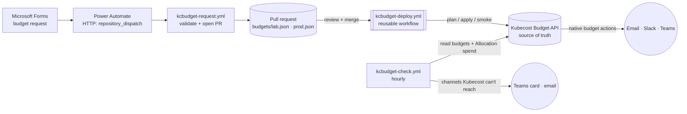

# Kubecost budgets as code (`kcbudget`)

Teams request budgets through **Microsoft Forms**. Each request becomes a reviewed pull request against a budget file. On merge, a **reusable GitHub workflow** syncs the file to the **Kubecost Budget API**, which is the source of truth from then on. Alerts go to each budget's own recipients by **email, Slack and Microsoft Teams**.



## Components
| Piece | What it does |
|---|---|
| `budgets/<env>.json` | Desired budgets, pools (allocations) and alert recipients. No secrets. |
| `kcbudget/` | Stdlib-only Python: `validate`, `doctor`, `plan`, `apply`, `smoke`, `check`, `export`, `request`. |
| `kcbudget-deploy.yml` | **Reusable workflow** (`workflow_call`). One command in one GitHub Environment. |
| `kcbudget-lab.yml` | PR → plan. Merge → apply with prune, then smoke test. |
| `kcbudget-prod.yml` | PR → plan (read creds). Merge → plan, then apply behind required reviewers. |
| `kcbudget-check.yml` | Hourly. Reads budgets from Kubecost, measures spend, sends repo-side alerts. |
| `kcbudget-request.yml` | Turns a Microsoft Forms submission into a validated PR. |

## Budget file
```json
{
  "managedPrefix": "kcb-",
  "allowedEmailDomains": ["example.com"],
  "defaults": {"kind": "soft", "interval": "monthly", "intervalDay": 1},
  "pools": {"bu-commerce": {"monthlyLimit": 1000}},
  "budgets": [{
    "name": "kcb-fraud-ns-tbm-payments-monthly",
    "owner": "fraud", "costCenter": "CC-1004", "pool": "bu-commerce",
    "values": {"namespace": ["tbm-payments"]},
    "spendLimit": 25,
    "alerts": [
      {"percentage": 50,  "emails": ["fraud-leads@example.com"]},
      {"percentage": 80,  "emails": ["fraud-leads@example.com"], "slack": ["commerce-alerts"]},
      {"percentage": 100, "emails": ["fraud-leads@example.com", "finops@example.com"],
       "slack": ["commerce-alerts", "finops-alerts"], "teams": ["commerce"]}
    ]
  }]
}
```
| Field | Rule |
|---|---|
| `name` | Must start with `managedPrefix`. Only prefixed budgets are managed; budgets made in the Kubecost UI are never changed or deleted. |
| `values` | Kubecost scope: `namespace` and/or `cluster` lists. Other keys pass through with a warning. |
| `interval` / `intervalDay` | `monthly` (day 1-28) or `weekly` (0-6, 0 = Sunday). |
| `alerts[].percentage` | Percent of `spendLimit` that triggers the alert (Kubecost `actions[].percentage`). |
| `alerts[].slack` / `.teams` | Channel **names** looked up in the `KCBUDGET_WEBHOOKS` secret, so URLs never sit in the repo. |
| `pool` | Allocation check: the monthly equivalent of all budgets in a pool must fit its `monthlyLimit` (weekly × 52/12). |
| `owner`, `costCenter`, `request` | Metadata for review and reporting; not sent to Kubecost. |

How it maps to the API: each budget becomes `POST /model/budget` with `name, values, kind, interval, intervalDay, spendLimit, actions[{percentage, emails, slackWebhooks, msTeamsWebhooks}]`. Updates send the same body with `id`. Deletes use `/model/deleteBudget?id=`. The client falls back to REST paths (`/model/budget/{id}`) if a build exposes those instead.

## Notifications
| Channel | Native (Kubecost budget actions) | Repo-side (`kcbudget check`) |
|---|---|---|
| Email | Needs SMTP configured inside Kubecost | Uses the `KCRESIZE_SMTP_*` secrets |
| Slack | Incoming webhook from `slackWebhooks` | Block message to the same webhooks |
| Teams | `msTeamsWebhooks`. May not render on Workflows URLs, since O365 connectors were retired in May 2026. | Adaptive Card to the same Workflows URLs |

Recipients always come from the budget in Kubecost, so both paths notify the same people. To avoid duplicates, pick the repo-side channels with `KCBUDGET_CHANNELS`. The default is `teams`. Add `email` if Kubecost has no SMTP. The checker remembers which thresholds it already sent in each period and resets when the period or limit changes.

## The 50 lab budgets (`budgets/lab.json`)
| Group | Count | Purpose |
|---|---|---|
| Cluster envelope `kcb-cl-kcresize-lab-monthly` | 1 | $600 per month for the whole lab |
| Tripwires on `tbm-payments`, `shop-prod`, `kubecost` | 3 | $0.50 to $1 per week. These exceed within hours, so every channel gets tested end to end. |
| Real lab namespaces, plus a shop roll-up | 6 | Realistic limits on namespaces that run workloads |
| Example org: 20 teams × prod (monthly) + dev (weekly) | 40 | Exercises naming, pools, mixed intervals, day-15 resets. These report $0 unless the namespaces exist. |

Three pools (`bu-commerce`, `bu-platform`, `bu-data`) are each about 85% allocated, so one large request will fail validation on purpose.

## Setup
1. **Environments** (Settings → Environments):
   - `kcbudget-lab`: optional `KUBECOST_URL` (otherwise the repo variable is used); secret `KCBUDGET_WEBHOOKS`.
   - `kcbudget-prod-plan`: prod `KUBECOST_URL`, read-only Kubecost credentials, `KCBUDGET_WEBHOOKS`. No reviewers.
   - `kcbudget-prod`: same plus write credentials. **Required reviewers** and branch rule `main`.
2. **Webhooks secret**: copy [`examples/budgets/webhooks.example.json`](../examples/budgets/webhooks.example.json), put in real Slack and Teams Workflows URLs, and save it as `KCBUDGET_WEBHOOKS` in each environment.
3. **Runners**: the lab uses `vars.KCRESIZE_RUNS_ON` (the self-hosted lab runner). Prod uses `vars.KCBUDGET_PROD_RUNS_ON`, which needs a runner that can reach the prod Kubecost.
4. **First run**:
   1. Run **kcbudget - lab** manually with `doctor`. This confirms the Budget API paths on your Kubecost version.
   2. Run it with `plan`, then `apply`.
   3. Run **kcbudget - check** and confirm the tripwire alerts arrive.
5. **Adopt existing prod budgets** (optional): run `python -m kcbudget export --prefix kcb-` against prod and paste the output into `budgets/prod.json`.

Locally against the lab:
```bash
export PYTHONPATH=. KUBECOST_URL=http://localhost:9091 KCBUDGET_WEBHOOKS="$(cat webhooks.json)"
python3 -m kcbudget doctor
python3 -m kcbudget plan  --file budgets/lab.json
python3 -m kcbudget apply --file budgets/lab.json --prune
python3 -m kcbudget smoke
KCBUDGET_NOTIFY_DRY_RUN=1 python3 -m kcbudget check --channels email,slack,teams   # payloads -> .kcresize/outbox/
```

## Microsoft Forms intake
1. **Create the form** from [`examples/forms/budget-request-form.md`](../examples/forms/budget-request-form.md). Use choice questions for environment, scope type, interval, thresholds and channels, so answers are always valid names.
2. **Build the Power Automate flow:**
   1. Trigger: **When a new response is submitted**.
   2. Action: **Get response details**.
   3. Action: **HTTP** (premium connector), `POST https://api.github.com/repos/ttdeangel/kc-lab/dispatches`.
      - Headers: `Authorization: Bearer <fine-grained PAT: this repo, Contents read/write>`, `Accept: application/vnd.github+json`.
      - Body: [`examples/forms/power-automate-http-body.json`](../examples/forms/power-automate-http-body.json).
   4. Store the PAT in Azure Key Vault or a secure flow input, not in plain text.
3. **What happens next:** `kcbudget-request.yml` validates the request against the target file:
   - Naming
   - Email domain allowlist
   - Known channel names
   - Pool headroom

   It then opens a PR labelled `kcbudget-request`. An invalid request fails the run with the reason, and nothing is written.
4. **Approval:** reviewers approve the PR (add `CODEOWNERS` for `budgets/prod.json`). Merging deploys it.
5. **Without the premium HTTP connector:** have the flow create a GitHub issue with the standard GitHub connector and handle it with a small issue workflow. That path isn't included here.

## Guardrails
- **Validation before any API call:** names, scopes, alert recipients, channel names (not URLs), email domains and pool headroom.
- **Prune limits:** prune deletes only prefixed budgets. `--max-deletes` caps each run (lab 50, prod 5). Prod prunes only when someone asks for it on a manual run.
- **Strict mode in prod:** a channel name missing from `KCBUDGET_WEBHOOKS` fails the run. In the lab, it's a warning.
- **No leaked webhooks:** URLs are masked in plans, summaries and `export`.
- **Smoke test:** create → read → update → delete of a throwaway `kcb-smoke-<run>` budget proves the write path after every lab deploy.
- **Paused lab:** when `KUBECOST_URL` is empty (`kcctl pause`), every job skips with a notice.

## Caveats
- The Budget API paths come from Kubecost's published Budget API docs. They have **not yet been verified on Kubecost 3.3.1**, unlike the Actions endpoints in [kubecost-api-notes.md](kubecost-api-notes.md). Run `doctor` and `smoke` first. If your build differs, set `KCBUDGET_API_STYLE=rest` and record what you find in the notes.
- `check` estimates the period from `interval` and `intervalDay` in UTC. It supports `namespace` and `cluster` scopes. Kubecost's own budget view is authoritative for exact totals.
- Kubecost budgets are alerts only. `kind: hard` is stored, but nothing blocks deployments.
