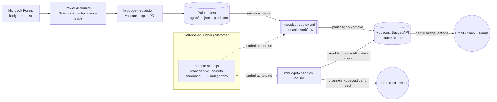

# Kubecost budgets as code (`kcbudget`)

Teams request budgets through **Microsoft Forms**. Each request becomes a reviewed pull request against a budget file. On merge, a **reusable GitHub workflow** syncs the file to the **Kubecost Budget API**, which is the source of truth from then on. Alerts go to each budget's own recipients by **email, Slack and Microsoft Teams**.

**No secrets or keys are stored in GitHub.** Webhook URLs, Kubecost credentials and SMTP settings are loaded at runtime on the runner, from its environment, an env file, or a secrets command the customer supplies ([Runtime settings](#runtime-settings-no-github-secrets)). The Forms flow reaches GitHub through Power Automate's GitHub connector (an OAuth sign-in owned by the customer), not a token kept in GitHub.



## Components
| Piece | What it does |
|---|---|
| `budgets/<env>.json` | Desired budgets, pools (allocations) and alert recipients. No secrets. |
| `kcbudget/` | Stdlib-only Python: `preflight`, `validate`, `doctor`, `plan`, `apply`, `smoke`, `check`, `export`, `request`. |
| `kcbudget/runtime.py` | Loads settings at runtime on the runner; the customer carve-out for secrets. |
| `kcbudget-deploy.yml` | **Reusable workflow** (`workflow_call`). One command in one GitHub Environment. |
| `kcbudget-lab.yml` | PR → plan. Merge → apply with prune, then smoke test. |
| `kcbudget-prod.yml` | PR → plan (read creds). Merge → plan, then apply behind required reviewers. |
| `kcbudget-check.yml` | Hourly. Reads budgets from Kubecost, measures spend, sends repo-side alerts. |
| `kcbudget-request.yml` | Turns a Microsoft Forms submission (a `[kcbudget-request]` issue) into a validated PR, using only the built-in `GITHUB_TOKEN`. |

## Budget file
```json
{
  "managedPrefix": "kcb-",
  "allowedEmailDomains": ["example.com"],
  "defaults": {"kind": "soft", "interval": "monthly", "intervalDay": 1},
  "pools": {"bu-commerce": {"monthlyLimit": 1000}},
  "budgets": [{
    "name": "kcb-fraud-ns-tbm-payments-monthly",
    "owner": "fraud", "costCenter": "CC-1004", "pool": "bu-commerce",
    "values": {"namespace": ["tbm-payments"]},
    "spendLimit": 25,
    "alerts": [
      {"percentage": 50,  "emails": ["fraud-leads@example.com"]},
      {"percentage": 80,  "emails": ["fraud-leads@example.com"], "slack": ["commerce-alerts"]},
      {"percentage": 100, "emails": ["fraud-leads@example.com", "finops@example.com"],
       "slack": ["commerce-alerts", "finops-alerts"], "teams": ["commerce"]}
    ]
  }]
}
```
| Field | Rule |
|---|---|
| `name` | Must start with `managedPrefix`. Only prefixed budgets are managed; budgets made in the Kubecost UI are never changed or deleted. |
| `values` | Kubecost scope: `namespace` and/or `cluster` lists. Other keys pass through with a warning. |
| `interval` / `intervalDay` | `monthly` (day 1-28) or `weekly` (0-6, 0 = Sunday). |
| `alerts[].percentage` | Percent of `spendLimit` that triggers the alert (Kubecost `actions[].percentage`). |
| `alerts[].slack` / `.teams` | Channel **names**, resolved at runtime from `KCBUDGET_WEBHOOKS` on the runner, so URLs never sit in GitHub. |
| `pool` | Allocation check: the monthly equivalent of all budgets in a pool must fit its `monthlyLimit` (weekly × 52/12). |
| `owner`, `costCenter`, `request` | Metadata for review and reporting; not sent to Kubecost. |

How it maps to the API: each budget becomes `POST /model/budget` with `name, values, kind, interval, intervalDay, spendLimit, actions[{percentage, emails, slackWebhooks, msTeamsWebhooks}]`. Updates send the same body with `id`. Deletes use `/model/deleteBudget?id=`. The client falls back to REST paths (`/model/budget/{id}`) if a build exposes those instead.

## Notifications
| Channel | Native (Kubecost budget actions) | Repo-side (`kcbudget check`) |
|---|---|---|
| Email | Needs SMTP configured inside Kubecost | Uses `KCRESIZE_SMTP_*` runtime settings on the runner |
| Slack | Incoming webhook from `slackWebhooks` | Block message to the same webhooks |
| Teams | `msTeamsWebhooks`. May not render on Workflows URLs, since O365 connectors were retired in May 2026. | Adaptive Card to the same Workflows URLs |

Recipients always come from the budget in Kubecost, so both paths notify the same people. To avoid duplicates, pick the repo-side channels with `KCBUDGET_CHANNELS`. The default is `teams`. Add `email` if Kubecost has no SMTP. The checker remembers which thresholds it already sent in each period and resets when the period or limit changes.

## The 50 lab budgets (`budgets/lab.json`)
| Group | Count | Purpose |
|---|---|---|
| Cluster envelope `kcb-cl-kcresize-lab-monthly` | 1 | $600 per month for the whole lab |
| Tripwires on `tbm-payments`, `shop-prod`, `kubecost` | 3 | $0.50 to $1 per week. These exceed within hours, so every channel gets tested end to end. |
| Real lab namespaces, plus a shop roll-up | 6 | Realistic limits on namespaces that run workloads |
| Example org: 20 teams × prod (monthly) + dev (weekly) | 40 | Exercises naming, pools, mixed intervals, day-15 resets. These report $0 unless the namespaces exist. |

Three pools (`bu-commerce`, `bu-platform`, `bu-data`) are each about 85% allocated, so one large request will fail validation on purpose.

## Runtime settings (no GitHub secrets)
kcbudget reads every sensitive value when it starts, on the machine that runs it. The first non-empty value wins:

| Order | Source | Who implements it |
|---|---|---|
| 1 | The runner's process environment (runner service env, a Kubernetes Secret mounted as env on an ARC runner pod) | Customer |
| 2 | `KCBUDGET_SECRETS_COMMAND`: a command that prints JSON or `KEY=VALUE` lines. This is the **carve-out** for Vault, AWS Secrets Manager, Azure Key Vault and similar. | Customer ([examples/secrets-providers/](../examples/secrets-providers/README.md)) |
| 3 | `KCBUDGET_ENV_FILE`. Default: `~/.kcbudget/<github-environment>.env` on the runner (chmod 600). | Customer ([example](../examples/budgets/kcbudget.env.example)) |

| Key | Purpose |
|---|---|
| `KUBECOST_URL` | Kubecost API. If it is missing, the job skips with a notice, as it does for a paused lab. |
| `KUBECOST_AUTH_HEADER` or `KUBECOST_BASIC_USER` / `KUBECOST_BASIC_PASSWORD` | Kubecost behind auth |
| `KCBUDGET_WEBHOOKS` (JSON) or `KCBUDGET_WEBHOOKS_FILE` (path) | Slack and Teams channel names → URLs ([shape](../examples/budgets/webhooks.example.json)) |
| `KCRESIZE_SMTP_HOST/PORT/USER/PASSWORD/FROM` | `check --channels email` |

Safeguards:
- Only `KUBECOST_*`, `KCBUDGET_*` and `KCRESIZE_SMTP_*` keys are accepted, so a provider cannot change `PATH` and similar settings.
- In Actions, loaded credentials and webhook URLs are masked in the log.
- `preflight` reports which keys are present, never their values.
- The env file name follows the GitHub Environment, which keeps read and write credentials apart: `kcbudget-prod-plan.env` is read-only (plan, check), and `kcbudget-prod.env` can write (apply, behind reviewers).

GitHub carries only **non-secret** configuration, as optional (environment) variables: `KUBECOST_URL`, `KUBECOST_UI_URL`, `KCBUDGET_SECRETS_COMMAND` (a path), `KCBUDGET_ENV_FILE`, `KCBUDGET_WEBHOOKS_FILE`, `KCBUDGET_CHANNELS`, `KCBUDGET_API_STYLE` and the runner labels. Because the settings live on the runner, lab and prod need **self-hosted runners**.

## Setup
1. **Runners:** the lab uses the existing self-hosted runner (`vars.KCRESIZE_RUNS_ON`). Prod needs a self-hosted runner that can reach the prod Kubecost; set `vars.KCBUDGET_PROD_RUNS_ON` to its labels.
2. **Runtime settings on each runner:** pick one source per environment:
   ```bash
   mkdir -p ~/.kcbudget && chmod 700 ~/.kcbudget
   cp examples/budgets/kcbudget.env.example     ~/.kcbudget/kcbudget-lab.env
   cp examples/budgets/webhooks.example.json    ~/.kcbudget/kcbudget-lab.webhooks.json   # real Slack/Teams URLs
   chmod 600 ~/.kcbudget/*
   ```
   Or set `KCBUDGET_SECRETS_COMMAND` to a provider script ([examples](../examples/secrets-providers/README.md)).
3. **GitHub Environments** (no secrets in any of them):
   - `kcbudget-lab`
   - `kcbudget-prod-plan`: no reviewers.
   - `kcbudget-prod`: **required reviewers**, deployments only from `main`.
4. **First run:**
   1. Run **kcbudget - lab** manually with `doctor`. This confirms the Budget API paths on your Kubecost version.
   2. Run it with `plan`, then `apply`.
   3. Run **kcbudget - check** and confirm the tripwire alerts arrive.
5. **Adopt existing prod budgets** (optional): run `python -m kcbudget export --prefix kcb-` on the prod runner and paste the output into `budgets/prod.json`.

### Local end-to-end test (one command)
`./lab/budget-e2e.sh` (or `kcctl budget-test`) runs every step below against the lab. Each step is checked, prints PASS/FAIL/SKIP, and stops at the first failure, which names its log:

| Step | Passes when |
|---|---|
| tools | `python3` and `curl` are installed, plus `docker` for Mailpit |
| mail | Mailpit is up with an empty inbox, or the SMTP server is reachable |
| preflight / doctor | `KUBECOST_URL` is found, and the Budget and Allocation APIs respond |
| validate | The test copy of `budgets/lab.json` has 50 valid budgets |
| apply / replan | All 50 managed budgets are in Kubecost, then a second plan shows 0 changes |
| smoke | A throwaway budget can be created, read, updated and deleted |
| dry-run | Alert emails are written to the outbox and nothing is sent |
| send | The alerts are sent. Mailpit arrival is confirmed through its API; with real SMTP, you confirm. |
| dedupe | A second check sends nothing new in the same period |
| intake | A simulated Forms issue becomes a budget in Kubecost |
| restore | Kubecost matches `budgets/lab.json` again |

It asks at start-up for:
- the Kubecost URL (default: the lab's port, normally 9090)
- the email mode: `mailpit` (local inbox, the default), `smtp` (real mail) or `dry-run`
- an optional single test recipient
- whether to force the tripwire budgets to $0.01, run the intake step, and keep the test budgets afterwards

Answers are saved in `.lab/<cluster>/budget-e2e.answers`, except the SMTP password, which is never written to disk. Repeat runs only need `-y`. Every option also has a flag (see `--help`). The run works on a copy of the budget file and never changes the repository.

```bash
./lab/budget-e2e.sh                     # first run: answer the prompts
./lab/budget-e2e.sh -y                  # repeat with the same answers
./lab/budget-e2e.sh -y --mode smtp --to me@corp.com   # real mail (password from KCRESIZE_SMTP_PASSWORD or a prompt)
```

Manually, step by step:
```bash
export PYTHONPATH=. KCBUDGET_ENV=kcbudget-lab          # loads ~/.kcbudget/kcbudget-lab.env
python3 -m kcbudget preflight
python3 -m kcbudget doctor
python3 -m kcbudget plan  --file budgets/lab.json
python3 -m kcbudget apply --file budgets/lab.json --prune
python3 -m kcbudget smoke
KCBUDGET_NOTIFY_DRY_RUN=1 python3 -m kcbudget check --channels email,slack,teams   # payloads -> .kcresize/outbox/
```

## Microsoft Forms intake
No GitHub token or key is created or stored. The customer owns the Power Automate side.
1. **Create the form** from [`examples/forms/budget-request-form.md`](../examples/forms/budget-request-form.md). Use choice questions for environment, scope type, interval, thresholds and channels, so answers are always valid names.
2. **Build the Power Automate flow** ([`power-automate-issue-body.md`](../examples/forms/power-automate-issue-body.md)):
   1. Trigger: **When a new response is submitted**.
   2. Action: **Get response details**.
   3. Action: GitHub connector **Create an issue**, titled `[kcbudget-request] <team>`, with the answers in a ` ```json ` block. The connector signs in with OAuth as a bot or service account that has write access.
3. **What happens next:** `kcbudget-request.yml` runs only for `[kcbudget-request]` issues from `OWNER`, `MEMBER` or `COLLABORATOR` authors. It validates the request against `budgets/<environment>.json`:
   - Naming
   - Email domain allowlist
   - Known channel names
   - Pool headroom

   It then opens a PR (`Closes #<issue>`) and links it on the issue. A rejected request gets a comment with the reasons; edit the issue or resubmit the form to retry.
4. **Approval:** reviewers approve the PR (add `CODEOWNERS` for `budgets/prod.json`). Merging deploys it.
5. **Public repository:** issue text is public, so use a private repository for production requests.

## Guardrails
- **Validation before any API call:** names, scopes, alert recipients, channel names (not URLs), email domains and pool headroom.
- **Prune limits:** prune deletes only prefixed budgets. `--max-deletes` caps each run (lab 50, prod 5). Prod prunes only when someone asks for it on a manual run.
- **Strict mode in prod:** a channel name missing from the runtime `KCBUDGET_WEBHOOKS` fails the run. In the lab, it's a warning.
- **No GitHub secrets:** workflows reference no `secrets.*`; the request workflow uses only the built-in `GITHUB_TOKEN`.
- **No leaked webhooks:** URLs are masked in plans, summaries and `export`.
- **Smoke test:** create → read → update → delete of a throwaway `kcb-smoke-<run>` budget proves the write path after every lab deploy.
- **Paused lab:** when `KUBECOST_URL` is empty (`kcctl pause`), every job skips with a notice.

## Caveats
- The Budget API paths come from Kubecost's published Budget API docs. They have **not yet been verified on Kubecost 3.3.1**, unlike the Actions endpoints in [kubecost-api-notes.md](kubecost-api-notes.md). Run `doctor` and `smoke` first. If your build differs, set `KCBUDGET_API_STYLE=rest` and record what you find in the notes.
- `check` estimates the period from `interval` and `intervalDay` in UTC. It supports `namespace` and `cluster` scopes. Kubecost's own budget view is authoritative for exact totals.
- Kubecost budgets are alerts only. `kind: hard` is stored, but nothing blocks deployments.
